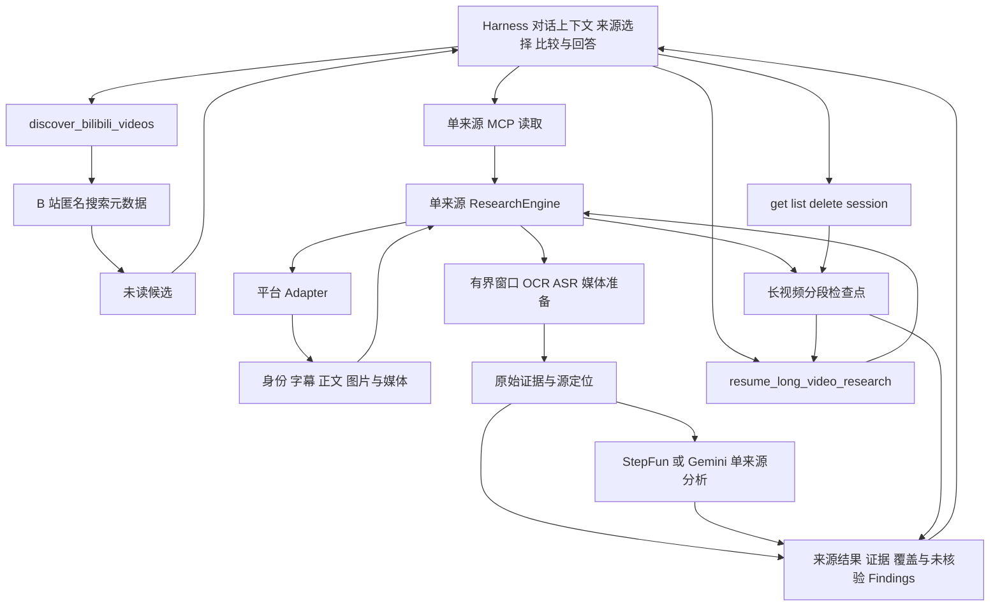

# Catalyst 架构

Catalyst 为宿主 Agent（harness）读取单个视频或笔记，返回原始文字、源时间／图片页码、覆盖范围、可用状态和该来源的模型分析。平台获取、字幕／ASR、图片 OCR、视频窗口准备和单来源分析由 Catalyst 完成；对话上下文、来源选择、多个来源的综合与比较、换问题后的回答由宿主负责。

用户先提供 A、B，再补充 C 时，宿主保留 A、B 的工具结果，只调用来源工具读取 C。新问题可以直接使用已有原始文字。长视频证据不在上下文时，`get_research_session` 可只读取回；图文结果由宿主保留。无需在 Catalyst 创建一个覆盖这些对话的多来源研究或子任务。

## 默认调用路径

`analyze_long_video_url` 读取一个完整视频、B 站分 P 或显式所选范围，在共享期限和文件预算内进行分段概览与有界精读。`long-video.ts` 保留分段状态，`media-window.ts` 按源时间获取、校验和准备媒体。概览、精读和未读区间分别报告；失败段不能作为最终 Findings 的引用来源。B 站入口统一解析分 P，确保 CID、时长、下载 URL 和 `metadata.part_title` 一致。详见[长视频读取](./long-video.md)。

长视频默认保存读取检查点。`resume_long_video_research` 核对来源和配置后，只处理未完成或失败段，保留已完成段的原始文字、报告和引用，再重新综合该来源的回答。每段结束后原子写入脱敏快照，服务重启后仍可恢复。记录不保存媒体、凭据或签名获取地址。`get_research_session` 和 `list_research_sessions` 不调用来源或 Provider；`delete_research_session` 只删除未被运行进程占用的本地记录。详见[保存与恢复](./research-sessions.md)。

`analyze_video_url` 处理一个视频或明确时间窗，通用媒体窗口至多 900 秒；`analyze_xiaohongshu_note` 读取笔记正文、按页 OCR 或图片画面，确认是视频时路由到视频引擎。`analyze_video`、`inspect_video_window` 和 `analyze_bilibili_video` 保留原 BVR 接口。模型调用可形成来源内部的报告，但跨来源结论由宿主组织。

`discover_bilibili_videos` 取得有界匿名搜索元数据，规范化身份并按实际查询排名融合排序。宿主选择候选后，再调用读取工具核对实际来源、分 P 和时长并获取内容证据。搜索标题、简介和排名不是已读证据，命中不证明媒体可获取。详见[候选发现](./discovery.md)。

默认共 11 个工具：3 个原 BVR 工具、`analyze_video_url`、`analyze_long_video_url`、`analyze_xiaohongshu_note`、`discover_bilibili_videos`，以及 4 个长视频 session 管理／恢复工具。每次读取接受一个来源，来源组合和对话轮次由宿主管理；各次读取仍有自己的范围、期限和材料预算。

## 模块职责

| 默认来源层模块 | 职责 |
| --- | --- |
| `src/index.ts` | 默认 stdio 启动入口。 |
| `src/mcp-server.ts` | `createCatalystServer()`，注册 11 个来源读取、搜索及 session 工具，适配 MCP 输入输出。 |
| `src/contracts.ts`、`src/result-schema.ts` | 来源身份、能力、Evidence、Finding、失败与结构化结果；校验字段和引用结构，不裁决语义。 |
| `src/adapters/` | URL 与来源身份校验，平台元数据和字幕获取，可选评论及平台认证。 |
| `src/acquisition.ts`、`src/media-window.ts` | 下载器选择、有界媒体获取、时间窗验证、实际质量和临时产物清理。 |
| `src/research.ts` | 单视频三种证据模式、窗口与期限、证据组织、引用校验及部分失败。 |
| `src/long-video.ts`、`src/long-video-continuation.ts` | 单视频分段概览与精读、检查点、覆盖和续跑兼容校验。 |
| `src/research-sessions.ts`、`src/research-session-store.ts` | 长视频持久快照、Provider 兼容性、原子保存、版本与锁、恢复和显式删除；原有的新问题追问分支由兼容层调用。 |
| `src/note-research.ts`、`src/note-contracts.ts`、`src/note-result-schema.ts` | 小红书正文、逐页 OCR／视觉证据及确认后的视频路由。 |
| `src/note-visual-output.ts` | 图文视觉批次的原生输出 schema、严格观察数组校验；校验后由程序按输入位置绑定原页。 |
| `src/note-answer.ts` | 复用引用检查，以接受的图文 Findings、原页和逐点限制组装主答案；不采用独立模型 `analysis` 或无引用自由文本。 |
| `src/discovery.ts`、`src/bilibili-search.ts`、`src/discovery-contracts.ts`、`src/discovery-schema.ts` | 有界候选查询、身份去重、排名依据、访问状态与独立候选契约。 |
| `src/video-analysis.ts`、`src/media-quality.ts` | 静音、音轨和片段准备，StepFun／Gemini 调用与质量选择。 |
| `src/process.ts` | 有期限和输出上限的子进程，取消时清理进程组或进程树。 |
| `src/doctor.ts` | 本机依赖与配置存在性检查，不调用平台或 Provider。 |

| 兼容编排层模块 | 保留职责 |
| --- | --- |
| `src/legacy-research.ts`、`src/legacy-workflow-tools.ts` | 显式兼容 stdio 入口，注册额外 9 个旧流程工具。 |
| `src/link-research.ts`、`src/link-research-contracts.ts`、`src/link-research-schema.ts`、`src/link-research-tools.ts` | 固定问题和 1–3 来源的旧链接任务、追问、预算与 MCP 适配。 |
| `src/link-research-materials.ts`、`src/link-research-receipts.ts`、`src/task-followup-materials.ts` | 来源材料合并、回执验收、父子文字快照与新视觉证据。 |
| `src/link-research-store.ts`、`src/research-task-store.ts` | v1／v2 任务读取兼容，原子快照、版本和跨进程锁。 |
| `src/research-tasks.ts`、`src/research-task-cli.ts` | v1 固定动作轮次、任务 CLI；CLI 自动连接兼容服务。 |
| `src/followup-plan*.ts` | 旧确定性覆盖规划、缺口、历史与有界动作建议。 |
| `src/comparison*.ts` | 已选材料的摘录和引用校验、一次文本对照或追问回答。 |
| `src/long-video-materials.ts` | 旧长视频新问题分支的原始语言材料提取和父记录校验。 |
| `src/research-source-evidence.ts` | 兼容任务／快照的来源、分 P 和原始证据范围校验。 |

## 统一素材

候选发现返回 `DiscoveryResult`，与 `ResearchResult` 分开。候选中的标题、简介、作者和搜索时长用于来源筛选；`content_status` 固定为 `not_read`，`media_access` 固定为 `not_checked`，不进入 Evidence 或 Findings。查询命中记录保留原始排名，重复身份合并后仍可追溯至全部查询。RRF 分数是排序基线，不是事实可信度。候选送入研究工具后，才重新解析实际分 P、CID 和时长，并取得内容素材。

`SourceContext` 包含视频身份、字幕轨、评论和独立的能力状态。`VideoIdentity` 保留平台内容 ID、分 P 身份、原始 URL 与规范 URL。B 站的页面身份和时间长度应与所下载媒体一致；YouTube 的链接形式归一化到具体视频。

每种素材分别记录 `available`、`absent`、`unsupported`、`disabled`、`not_requested`、`error`、`auth_required`、`blocked` 或 `unknown`。例如没有字幕与字幕接口失败是不同状态。YouTube 评论采样在本预览版返回 `unsupported`，而非空评论样本。

小红书接收笔记 URL、官方短链或包含单条 URL 的分享文案。输入的 HTTP 短链先升级为 HTTPS，短链跳转逐步校验域名、协议和次数；提供的分享参数保留到下载器调用，对外结果 URL 只保留公开查询字段。源时长优先使用顶层元数据，否则只接受相互一致的流时长，不根据文件大小猜测。当前下载器不提供小红书字幕和评论，分别标记 `unsupported`，语言研究使用显式 ASR 回退。无格式结果为 `MEDIA_UNAVAILABLE`，不能据此认定为图文笔记。

`MediaAsset` 是请求内部的媒体引用，携带尺寸、帧率、下载字节和质量信息，并提供清理方法。媒体不会因为一次请求完成而获得永久可复查引用；对外 Evidence 保留原始来源和源窗口，必要时重新获取。

## 三种证据路径

小红书图文使用独立的 `note-contracts.ts`、`note-result-schema.ts` 和 `note-research.ts`，入口为 `analyze_xiaohongshu_note`。其外层结果声明 `content_type`，图文结果使用 `note` 与逐页证据，确认是视频时嵌入已有视频研究结果。原有 `analyze_video_url` 的输出契约保持不变；图文不伪装成零时长视频。

笔记获取读取受限大小的移动端页面，只用 JSON 安全解析服务端状态，验证实际笔记身份和类型。正文与有序图片分别获取，分享参数和 CDN 地址仅用于内部访问，输出引用规范笔记 URL。图文页面目前采用匿名获取，不读取浏览器会话；视频下载器的 Cookie 配置不自动成为图文页面登录态。

`text` 路径使用平台正文与逐页 OCR；`vision` 路径以最多四张图片为一批，生成对应页的视觉观察；`combined` 分别保存两者，再用这些证据回答。OCR 优先使用 macOS Swift/Vision，缺少运行时时回退到已配置 Provider 的图片转写。生成的 OCR 和视觉观察都标明来源与局限，不等同于独立核验的事实。指定页范围时只研究对应原始页码，不把整篇正文混入页内证据。

每次最多研究 50 张图片，超出时要求选页；每图最多 12 MiB、下载总量 128 MiB，内联模型图片请求另有 19 MB 上限。下载、OCR 与模型共用期限和取消信号，临时文件在结束后删除。OCR 另有进程内缓存，按图片内容哈希、语言和引擎/Provider 配置区分，最多 128 页、100 万字符、30 分钟；缓存不落盘，失败和空文本不入缓存。仍会重新获取来源图片以确认内容，答案不缓存。

获取层优先协商 JPEG、PNG、WebP、GIF；CDN 仍返回 AVIF 时，在返回图片资产前复用 FFmpeg 转为单帧 PNG。转码继承取消与期限，限制解码像素和单次内存分配，并验证 PNG 签名、实际尺寸、单图及累计产物字节；原始 AVIF 与失败产物均清理。输入下载量和转换后保留量分别受 128 MiB 总预算约束，`download_bytes` 始终表示网络下载字节。下游 OCR 与两种图片 Provider 共用同一份规范化图片。

- `language`：优先筛选请求窗口内的平台字幕 cue。无可用字幕时，抽取音频并转写，随后用语言证据回答。ASR 无分段对齐时只记录被提交的源区间。
- `vision`：对整个所选素材或指定片段移除音轨，将静音画面交给 Provider。
- `multimodal`：对原视频或所选片段同时使用声音与画面。

通用媒体研究单次最多处理 900 秒。超过该范围时要求显式缩小窗口并返回 `WINDOW_REQUIRED`。字幕路径使用独立的文本预算，过大的字幕请求同样需要缩小窗口。旧 BVR 工具保留原有长视觉视频粗扫与精扫流程。

## 证据与模型结论

程序创建的 Evidence 与模型解释分开保存。字幕时间来自实际 cue；静音或原媒体 Evidence 的时间只确定送去研究的源区间。Provider 没有给出确定性采样映射时，模型帧号和精确时刻不会成为已验证的抽帧证据。

模型被要求用已有证据 ID 引用结论。引擎会拒收无效 ID、没有主要语言或视觉证据的结论，以及格式不合要求的引用。有效引用仍只代表结构成立：所有模型 Finding 标记为 `verification: "unverified"`，语义正确性需要回到原始字幕或画面核验。

不要求结构化模型输出成功才能保留已有证据。非结构化返回会保留分析文本并给出告警，结果通常为 `partial`。媒体或 Provider 失败时，已获取的元数据和可用证据继续返回，错误记录阶段、代码和重试性质。

## 质量与预算

长视频按完整所选视频或分 P 规划概览，默认每段 600 秒、最多 12 段；超出预检上限时拒绝，不截断为开头采样。默认共享期限为 900 秒，最多 1,800 秒；单窗口默认 180 秒，可在 15–600 秒内设置。累计获取文件预算默认 512 MiB，单份准备后的媒体不超过 32 MiB；每段完成后清理临时媒体。概览上传最高 360p、1 fps，精读最高 720p、5 fps；完整概览不证明逐帧或逐公式理解。详见[长视频设计](./long-video.md)。

通用入口在未指定 `source_quality` 时使用可用源并报告实际质量。视觉和多模态下载默认优先选择不超过 1080p 的格式，源回退以实际报告为准；媒体文件预算默认 256 MiB，可通过 `CATALYST_MAX_MEDIA_MB` 调整。显式质量请求沿用 BVR 的标准档、高档和自定义档，目标不满足时默认报错。旧 B 站工具保留默认严格 1080p30 的语义。

新流程有统一期限，向下载器、媒体处理与 Provider 传播取消信号，并在结束后清理临时目录。下载器仍可能需要获取完整源文件，再在本地裁剪，所以小窗口不等于仅下载相同长度的内容。阶段耗时和下载字节用于观察这一成本；没有返回的 token usage 和金额保持未知。

长视频记录保存自身已完成分段的字幕／转写、报告和引用，用于恢复同一个问题。复用前验证平台身份、分 P、时长、模式、原问题、语言、画质、计划及分析配置；失败段与不完整报告重新处理。续跑后用有效分段重新综合，不复用旧的最终答案。下载量和阶段耗时表示本次调用，已保存的覆盖不计作本次获取。

独立读取调用之间没有共享媒体／转写缓存；保存记录只恢复其固定问题与窗口计划。跨问题对话由宿主使用已有原始字幕、ASR、正文或 OCR 回答。需要新的画面证据时，宿主选择明确时间窗或图片页，再发起一次来源读取。旧分析和视觉 Findings 继续保留原问题及派生观察性质，不升级为新问题的原始证据。

## 运行环境和认证

`YTDLP_PATH` 与 `YTDLP_PYTHON` 用于显式选择下载器和解释器；可选的内置下载器缺失时允许外部安装。YouTube 获取命令显式启用当前 Node 作为 JS runtime。`FFMPEG_PATH` 覆盖内置 FFmpeg 路径。

B 站仅使用 `BILIBILI_COOKIES_*` 配置，YouTube 仅使用 `YOUTUBE_COOKIES_*`，小红书仅使用 `XIAOHONGSHU_COOKIES_*`。没有显式认证配置时不会自动选择浏览器登录态。B 站字幕 API 获取与 yt-dlp 的认证通道分别处理：配置给下载器的浏览器来源不会自动成为字幕 API 会话，因此可能出现媒体可获取而字幕为 `auth_required`，随后走显式 ASR 回退的情况。`.env` 或宿主环境向 Provider 注入凭据，doctor 只报告是否已配置。

B 站候选发现单独使用匿名 Web 搜索路径，不读取上述下载器 Cookie 配置或浏览器登录态。首版每查询最多一页，不自动重试；HTTP 响应受 1 MiB 上限约束。阻断、认证要求或限流会停止剩余查询，普通单查询错误与成功候选一起保留。匿名路径可受平台限制，不能由一次返回成功宣称长期稳定。

## 旧流程兼容

默认 `src/index.ts` 只启动 `createCatalystServer()`，注册 11 个来源工具。`src/legacy-research.ts` 是单独的兼容入口：在相同来源工具上调用 `registerLegacyWorkflowTools()`，增加旧有 9 个流程工具。默认入口不导入该注册器；宿主不会在默认工具发现中看到多来源任务、对照、规划或追问。编译后显式使用 `node /absolute/path/to/Catalyst/dist/legacy-research.js` 才暴露全部 20 个工具。

兼容层包括 `start_research_task`、`continue_research_task`、`follow_up_research_task`、`get_research_task`、`list_research_tasks`、`delete_research_task`、`compare_research_materials`、`plan_research_followup` 和 `follow_up_long_video_research`。它保留既有 v1／v2 任务、比较引用校验、父子快照和预算／未知结果契约，用于继续已有集成。`research-task-cli.ts` 明确连接兼容入口；本地查看／列出／删除仍不启动服务或请求 Provider。已有任务和视频 session 不迁移、不删除，默认来源工具也可读取已有长视频 session。

这些流程属于兼容编排层，新宿主在自己的上下文中处理多个来源、换问题和比较。具体旧契约见[链接任务](./link-research.md)、[任务追问](./task-followup.md)、[多来源对照](./comparison.md)、[补读规划](./research-followup-plan.md)、[一轮任务](./research-tasks.md)与[长视频追问](./long-video-followup.md)。

原 BVR 的 `analyze_bilibili_video`、`analyze_video`、`inspect_video_window` 仍在默认来源工具中，原有测试继续作为回归基线。通用结构化结果、候选发现结果与旧文本呈现分别维护。跨平台搜索和后台调度未实现。
