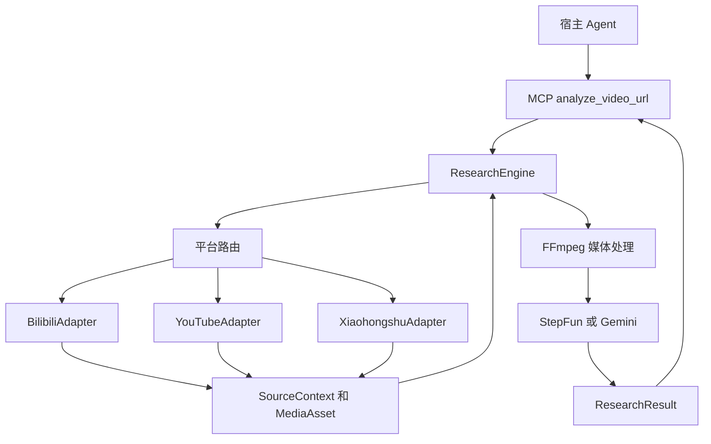

# Catalyst 首版架构

Catalyst 将平台获取与研究流程分开：平台 Adapter 提供统一素材，共用 ResearchEngine 决定如何使用字幕、音频和画面，MCP 层向宿主返回结构化结果与可读文本。当前覆盖 B 站、YouTube 和实验性小红书视频笔记，保留 BVR 的旧工具以便渐进迁移。

长视频使用 `analyze_long_video_url`：`long-video.ts` 在共享期限和文件预算内编排概览与精读，`media-window.ts` 负责按源时间获取、验证及准备有界媒体。分段结果、概览覆盖、精读覆盖和未读区间随结果返回，失败段不能作为最终 Findings 的引用来源。B 站通用与兼容入口共用分 P 解析，CID、时长和下载 URL 对齐，并保留 `metadata.part_title`。具体约束见[长视频设计与验收](./long-video.md)。

## 调用路径

## 模块职责

| 模块 | 职责 |
| --- | --- |
| `src/contracts.ts` | 平台身份、能力、字幕、媒体、Evidence、Finding、失败和结果契约。 |
| `src/result-schema.ts` | 与 MCP 工具发现一同暴露的结果 Schema，校验结构和字段；不承担结论语义验证。 |
| `src/process.ts` | 有期限和共享输出上限的子进程执行，以及取消时的进程组或进程树清理。 |
| `src/adapters/` | 校验来源 URL，取得元数据与语言素材，按平台管理可选评论和认证范围。 |
| `src/acquisition.ts` | 选择下载器运行环境、执行有界 yt-dlp 请求、取得媒体及实际质量、清理临时产物。 |
| `src/research.ts` | 三种研究模式、窗口校验、期限、证据组织、模型结果引用结构检查及部分失败结果。 |
| `src/video-analysis.ts` | 静音、音轨与片段变换，StepFun 和 Gemini 调用，兼容旧调用签名。 |
| `src/media-quality.ts` | 显式质量目标与格式选择、实际质量评估。 |
| `src/index.ts` | MCP 输入输出、通用入口与兼容入口。 |
| `src/doctor.ts` | 本机依赖版本与配置存在性诊断，不进行平台或模型请求。 |

## 统一素材

`SourceContext` 包含视频身份、字幕轨、评论和独立的能力状态。`VideoIdentity` 保留平台内容 ID、分 P 身份、原始 URL 与规范 URL。B 站的页面身份和时间长度应与所下载媒体一致；YouTube 的链接形式归一化到具体视频。

每种素材分别记录 `available`、`absent`、`unsupported`、`disabled`、`not_requested`、`error`、`auth_required`、`blocked` 或 `unknown`。例如没有字幕与字幕接口失败是不同状态。YouTube 评论采样在本预览版返回 `unsupported`，而非空评论样本。

小红书接收笔记 URL、官方短链或包含单条 URL 的分享文案。输入的 HTTP 短链先升级为 HTTPS，短链跳转逐步校验域名、协议和次数；提供的分享参数保留到下载器调用，对外结果 URL 只保留公开查询字段。源时长优先使用顶层元数据，否则只接受相互一致的流时长，不根据文件大小猜测。当前下载器不提供小红书字幕和评论，分别标记 `unsupported`，语言研究使用显式 ASR 回退。无格式结果为 `MEDIA_UNAVAILABLE`，不能据此认定为图文笔记。

`MediaAsset` 是请求内部的媒体引用，携带尺寸、帧率、下载字节和质量信息，并提供清理方法。媒体不会因为一次请求完成而获得永久可复查引用；对外 Evidence 保留原始来源和源窗口，必要时重新获取。

## 三种证据路径

小红书图文使用独立的 `note-contracts.ts`、`note-result-schema.ts` 和 `note-research.ts`，入口为 `analyze_xiaohongshu_note`。其外层结果声明 `content_type`，图文结果使用 `note` 与逐页证据，确认是视频时嵌入已有视频研究结果。原有 `analyze_video_url` 的输出契约保持不变；图文不伪装成零时长视频。

笔记获取读取受限大小的移动端页面，只用 JSON 安全解析服务端状态，验证实际笔记身份和类型。正文与有序图片分别获取，分享参数和 CDN 地址仅用于内部访问，输出引用规范笔记 URL。图文页面目前采用匿名获取，不读取浏览器会话；视频下载器的 Cookie 配置不自动成为图文页面登录态。

`text` 路径使用平台正文与逐页 OCR；`vision` 路径以最多四张图片为一批，生成对应页的视觉观察；`combined` 分别保存两者，再用这些证据回答。OCR 优先使用 macOS Swift/Vision，缺少运行时时回退到已配置 Provider 的图片转写。生成的 OCR 和视觉观察都标明来源与局限，不等同于独立核验的事实。指定页范围时只研究对应原始页码，不把整篇正文混入页内证据。

每次最多研究 50 张图片，超出时要求选页；每图最多 12 MiB、下载总量 128 MiB，内联模型图片请求另有 19 MB 上限。下载、OCR 与模型共用期限和取消信号，临时文件在结束后删除。OCR 另有进程内缓存，按图片内容哈希、语言和引擎/Provider 配置区分，最多 128 页、100 万字符、30 分钟；缓存不落盘，失败和空文本不入缓存。仍会重新获取来源图片以确认内容，答案不缓存。

获取层优先协商 JPEG、PNG、WebP、GIF；CDN 仍返回 AVIF 时，在返回图片资产前复用 FFmpeg 转为单帧 PNG。转码继承取消与期限，限制解码像素和单次内存分配，并验证 PNG 签名、实际尺寸、单图及累计产物字节；原始 AVIF 与失败产物均清理。输入下载量和转换后保留量分别受 128 MiB 总预算约束，`download_bytes` 始终表示网络下载字节。下游 OCR 与两种图片 Provider 共用同一份规范化图片。

- `language`：优先筛选请求窗口内的平台字幕 cue。无可用字幕时，抽取音频并转写，随后用语言证据回答。ASR 无分段对齐时只记录被提交的源区间。
- `vision`：对整个所选素材或指定片段移除音轨，将静音画面交给 Provider。
- `multimodal`：对原视频或所选片段同时使用声音与画面。

通用媒体研究单次最多处理 900 秒。超过该范围时要求显式缩小窗口并返回 `WINDOW_REQUIRED`。字幕路径使用独立的文本预算，过大的字幕请求同样需要缩小窗口。旧 BVR 工具保留原有长视觉视频粗扫与精扫流程。

## 证据与模型结论

程序创建的 Evidence 与模型解释分开保存。字幕时间来自实际 cue；静音或原媒体 Evidence 的时间只确定送去研究的源区间。Provider 没有给出确定性采样映射时，模型帧号和精确时刻不会成为已验证的抽帧证据。

模型被要求用已有证据 ID 引用结论。引擎会拒收无效 ID、没有主要语言或视觉证据的结论，以及格式不合要求的引用。有效引用仍只代表结构成立：所有模型 Finding 标记为 `verification: "unverified"`，语义正确性需要回到原始字幕或画面核验。

不要求结构化模型输出成功才能保留已有证据。非结构化返回会保留分析文本并给出告警，结果通常为 `partial`。媒体或 Provider 失败时，已获取的元数据和可用证据继续返回，错误记录阶段、代码和重试性质。

## 质量与预算

通用入口在未指定 `source_quality` 时使用可用源并报告实际质量。视觉和多模态下载默认优先选择不超过 1080p 的格式，源回退以实际报告为准；媒体文件预算默认 256 MiB，可通过 `CATALYST_MAX_MEDIA_MB` 调整。显式质量请求沿用 BVR 的标准档、高档和自定义档，目标不满足时默认报错。旧 B 站工具保留默认严格 1080p30 的语义。

新流程有统一期限，向下载器、媒体处理与 Provider 传播取消信号，并在结束后清理临时目录。下载器仍可能需要获取完整源文件，再在本地裁剪，所以小窗口不等于仅下载相同长度的内容。阶段耗时和下载字节用于观察这一成本；没有返回的 token usage 和金额保持未知。

首版没有跨请求持久媒体或转写缓存。获取/转写复用、答案缓存和 Provider 上下文复用需要分别确定缓存键、有效期与预算。

## 运行环境和认证

`YTDLP_PATH` 与 `YTDLP_PYTHON` 用于显式选择下载器和解释器；可选的内置下载器缺失时允许外部安装。YouTube 获取命令显式启用当前 Node 作为 JS runtime。`FFMPEG_PATH` 覆盖内置 FFmpeg 路径。

B 站仅使用 `BILIBILI_COOKIES_*` 配置，YouTube 仅使用 `YOUTUBE_COOKIES_*`，小红书仅使用 `XIAOHONGSHU_COOKIES_*`。没有显式认证配置时不会自动选择浏览器登录态。B 站字幕 API 获取与 yt-dlp 的认证通道分别处理：配置给下载器的浏览器来源不会自动成为字幕 API 会话，因此可能出现媒体可获取而字幕为 `auth_required`，随后走显式 ASR 回退的情况。`.env` 或宿主环境向 Provider 注入凭据，doctor 只报告是否已配置。

## 兼容边界

现有 `analyze_bilibili_video`、`analyze_video`、`inspect_video_window` 保留，原有 BVR 测试继续作为回归基线。通用入口的版本化结果与旧文本呈现分别维护。第一轮没有把跨平台搜索、长期调度或独立 Research Agent 纳入核心依赖。
